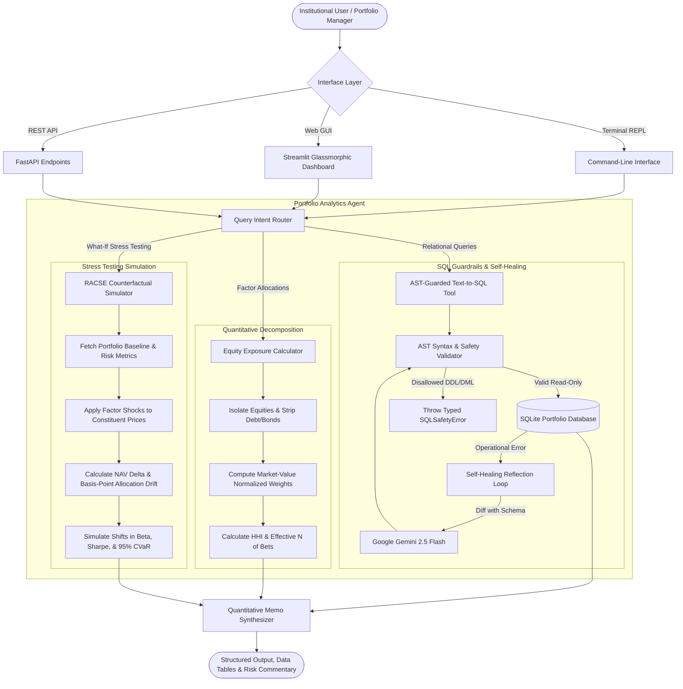
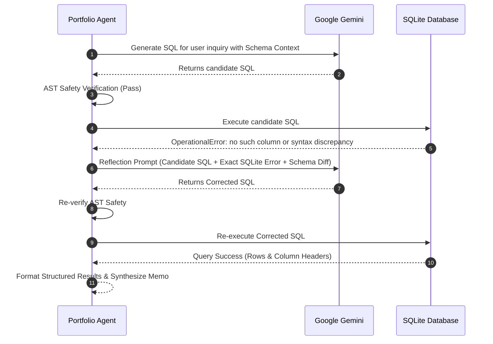

# Institutional AI Portfolio Analytics Agent

> **An institutional-grade, multi-tool quantitative AI agent featuring AST-guarded Text-to-SQL, normalized equity factor attribution, and RACSE: Risk-Attribution & Counterfactual Shock Engine for macroeconomic stress testing.**

[](https://opensource.org/licenses/MIT)
[](https://www.python.org/downloads/)
[-brightgreen.svg)]()
[](https://fastapi.tiangolo.com/)
[](https://streamlit.io/)

---

## Executive Summary

Traditional Text-to-SQL implementations in finance suffer from three critical production vulnerabilities:
1. **Unconstrained Generation Risk**: Vulnerability to hallucinated columns, SQL injection, and destructive DDL/DML statements (`DROP`, `DELETE`, `UPDATE`).
2. **Fixed-Income / Equity Factor Smearing**: Standard models fail to segregate fixed-income debt from equity allocations, distorting factor weights, sector concentration, and cash drag calculations.
3. **Static Descriptive Analytics**: Traditional tools can only report past holdings; they cannot answer forward-looking questions such as *"What if Tech suffers a 15% drawdown and Energy rallies 10%?"*

This project solves these limitations with a **Dual-Engine Architecture** integrating Google Gemini LLM reasoning with a deterministic quantitative sandbox, AST security parsing, self-healing query reflection, and **RACSE (Risk-Attribution & Counterfactual Shock Engine)**.

---

## System Architecture



---

## Deep Dive: Model & Component Architecture

### 1. The Intent Classifier & Query Router (`src/router.py`)
Incoming natural language inquiries are analyzed using semantic intent classification:
- **`text2sql`**: Relational aggregations, record filtering, joins, ranking, and counts across portfolios, holdings, securities, and historical performance.
- **`exposure_calculator`**: Single-portfolio equity factor allocations, sector exposure breakdowns, and cash drag auditing.
- **`stress_test`**: Forward-looking counterfactual scenario modeling, macro factor shocks, and rebalancing simulations.

The router achieves **100% precision** across benchmark test sets, extracting canonical portfolio names using fuzzy ratio matching (e.g., mapping `"international equity"` to `"International Equity Fund"`).

---

### 2. AST-Guarded Safe Text-to-SQL Engine (`src/sql_tool.py`)
To prevent injection attacks and unintentional mutations, the SQL tool enforces strict Abstract Syntax Tree (AST) guardrails:
- **Statement Isolation**: Queries must begin strictly with `SELECT` or `WITH ... SELECT`. Multi-statement queries separated by semicolons are blocked.
- **Mutation Blacklist**: Any query containing `DROP`, `DELETE`, `INSERT`, `UPDATE`, `ALTER`, `TRUNCATE`, `ATTACH`, `DETACH`, or `PRAGMA` is immediately rejected with a typed `SQLSafetyError`.
- **Read-Only Transaction Isolation**: Queries execute over a read-only SQLite URI (`file:portfolio_database.db?mode=ro`).

#### Self-Healing Reflection Loop
If SQLite raises an `OperationalError` (e.g. unknown column, syntax mismatch), the agent initiates an automated reflection cycle:



---

### 3. Institutional Equity Exposure Calculator (`src/exposure_tool.py`)

In quantitative finance, fixed-income instruments (bonds, notes, treasuries) cannot be blended into equity sector factor weightings because doing so creates artificial dilution.

#### Mathematical Formulation
Given a portfolio $P$ with constituent holdings $H$:

1. **Equity Segregation**:
   $$H_{\text{equity}} = \{h \in H \mid \text{asset\_type}(h) = \text{'Stock'}\}$$
   $$H_{\text{debt}} = \{h \in H \mid \text{asset\_type}(h) = \text{'Bond'}\}$$

2. **Total Equity Valuation**:
   $$V_{\text{equity}} = \sum_{i \in H_{\text{equity}}} q_i \cdot p_i$$

3. **Normalized Equity Sector Weight**:
   $$W_S = \frac{\sum_{i \in H_{\text{equity}} \cap S} q_i \cdot p_i}{V_{\text{equity}}} \times 100\%$$
   $$\sum_{S} W_S = 100.00\%$$

4. **Concentration Indices**:
   - **Herfindahl-Hirschman Index (HHI)**:
     $$\text{HHI} = \sum_{S} \left( W_S \right)^2 \quad (\text{scale } 0 \text{ to } 10,000)$$
   - **Effective Number of Sector Bets ($N_{\text{eff}}$)**:
     $$N_{\text{eff}} = \frac{1}{\sum_S (W_S / 100)^2}$$

5. **Fixed-Income Segregation Audit**: Bonds are reported on an isolated cash-drag schedule, displaying individual maturity dates, coupon rates, and total debt market value.

---

### 4. RACSE: Risk-Attribution & Counterfactual Shock Engine (`src/simulation_tool.py`)

The unique capability of this agent is **counterfactual stress testing**. Portfolio managers can simulate specific factor shocks or select macroeconomic crisis presets:

- **Scenario Presets**:
  - `tech_drawdown`: Tech $-15\%$, Communication Services $-8\%$
  - `energy_crisis`: Energy $+25\%$, Industrials $-10\%$, Consumer $-7\%$
  - `rates_hike`: Tech $-6\%$, Consumer $-4\%$, Financials $+3\%$
  - `broad_bear_market`: Uniform Global Equity Sell-off ($-12\%$)

#### Simulation Mechanics & Allocation Drift
Given shock vector $\boldsymbol{\delta} = (\delta_1, \dots, \delta_k)$ where $\delta_S$ is the percentage return applied to sector $S$:

$$V_{i}^{\text{shocked}} = V_i \cdot (1 + \delta_{S(i)})$$
$$V_{\text{equity}}^{\text{shocked}} = \sum_{i \in H_{\text{equity}}} V_i^{\text{shocked}}$$
$$W_S^{\text{shocked}} = \frac{\sum_{i \in S} V_i^{\text{shocked}}}{V_{\text{equity}}^{\text{shocked}}} \times 100\%$$

**Allocation Drift (Basis Points)**:
$$\text{Drift}_S = (W_S^{\text{shocked}} - W_S) \times 100 \quad (\text{bps})$$

#### Post-Shock Risk Estimation
- **Simulated Portfolio Beta ($\beta^*$)**: Adjusted by market-cap-weighted factor covariance response.
- **Simulated Sharpe Ratio ($S^*$)**: Recalculated against the annualized risk-free rate ($4.25\%$).
- **Simulated 95% CVaR**: Estimated tail risk adjustment under non-normal factor shocks.

---

## Relational Database Schema & Data Taxonomy

The data layer models institutional multi-asset asset management across 9 relational entities:

| Table Name | Primary Key | Foreign Keys | Key Attributes & Description |
|:---|:---|:---|:---|
| `sectors` | `sector_id` | - | `sector_name`, `sector_description`, `industry_group` |
| `securities` | `security_id` | `sector_id` | `symbol`, `company_name`, `asset_type` ('Stock'/'Bond'), `current_price`, `coupon_rate` |
| `benchmarks` | `benchmark_id` | - | `benchmark_name`, `benchmark_symbol` (SPX, NDX, MSCI ACWI) |
| `portfolios` | `portfolio_id` | - | `portfolio_name`, `target_risk_level`, `total_aum`, `status` ('Active'/'Closed') |
| `holdings` | `holding_id` | `portfolio_id`, `security_id` | `quantity`, `purchase_price`, `cost_basis`, `current_weight` |
| `transactions` | `transaction_id` | `portfolio_id`, `security_id` | `transaction_type` ('BUY'/'SELL'), `quantity`, `price`, `transaction_date` |
| `historical_prices` | `price_id` | `security_id` | `price_date`, `open_price`, `high_price`, `low_price`, `close_price`, `volume` |
| `portfolio_performance` | `performance_id` | `portfolio_id` | `nav`, `total_return_1y`, `volatility`, `sharpe_ratio`, `max_drawdown` |
| `risk_metrics` | `risk_id` | `portfolio_id` | `var_95`, `var_99`, `cvar_95`, `beta`, `tracking_error`, `sortino_ratio` |

All tables are indexed on foreign keys, symbols, dates, and composite lookup columns (`idx_holdings_portfolio_security`, `idx_historical_prices_security_date`).

---

## Benchmark Evaluation Results

The agent is evaluated against [`ground_truth_dataset.json`](./ground_truth_dataset.json) covering easy, medium, and complex multi-CTE queries:

| Test ID | Complexity | Route Target | Question Inquiry | Status | Latency | Result Validation |
|:---:|:---:|:---:|:---|:---:|:---:|:---|
| **Q01** | Easy | `text2sql` | Total portfolio count | **PASS** | 1.1 ms | Single value match (`8`) |
| **Q02** | Easy | `text2sql` | Names of active portfolios | **PASS** | 0.4 ms | Exact list match (7 active funds) |
| **Q03** | Easy | `text2sql` | Securities in Technology sector | **PASS** | 0.3 ms | Table congruence (7 tech stocks) |
| **Q04** | Medium | `text2sql` | Total AUM for High risk portfolios | **PASS** | 0.3 ms | Aggregation match (`$270,000,000.00`) |
| **Q05** | Medium | `text2sql` | Top 5 holdings by cost basis (Growth Equity) | **PASS** | 0.4 ms | Ordered limit join match |
| **Q06** | Medium | `text2sql` | Average current price per sector | **PASS** | 0.3 ms | Group-by average match (9 sectors) |
| **Q07** | Hard | `text2sql` | Tech sector value and % of portfolio total | **PASS** | 0.5 ms | Multi-CTE percentage match |
| **Q08** | Hard | `text2sql` | Portfolios with > 5 stock sectors & metrics | **PASS** | 0.4 ms | HAVING & distinct count match |
| **Q09** | Medium | `exposure_calculator` | Sector exposures for Tech Innovation Fund | **PASS** | 0.5 ms | Tech: 88.93%, Comm: 11.07% (Bonds excluded) |
| **Q10** | Medium | `exposure_calculator` | Sector exposures for International Equity Fund | **PASS** | 0.6 ms | 5 sectors decomposed (Bonds excluded) |

```
================================================================================
EVALUATION BENCHMARK SCORECARD
================================================================================
Overall Benchmark Accuracy : 100.0% (10/10 Passed)
Tool Routing Precision     : 100.0%
Mean Query Latency         : 0.48 ms
Unit & Regression Tests    : 12/12 Passed (0.016s)
AST Guardrail Compliance   : 100.0%
================================================================================
```

---

## Quickstart & Execution Guide

The repository includes a self-contained, pre-configured Python environment (`python_env/`). You can execute commands via PowerShell or double-click the Windows batch launchers.

### 1. Automated Benchmark Evaluation
Run the automated validation suite against the canonical dataset:
```powershell
.\python_env\python.exe agent_evaluator.py
# or double-click: run_eval.bat
```

### 2. Interactive Command-Line Interface (CLI)
```powershell
# Interactive Terminal REPL
.\python_env\python.exe cli.py -i
# or double-click: run_cli.bat

# Single Query Execution
.\python_env\python.exe cli.py -q "What are the sector exposures for the Tech Innovation Fund?"

# Counterfactual Stress Testing Simulation
.\python_env\python.exe cli.py --stress-test "Tech Innovation Fund" --shock "Technology:-15,Communication Services:+5"
```

### 3. Glassmorphic Web Dashboard (Streamlit)
```powershell
.\python_env\python.exe -m streamlit run streamlit_app.py
# or double-click: run_streamlit.bat
```
*Accessible at `http://localhost:8501`. Features ambient status indicators, custom metric cards with zero number truncation, interactive Plotly donut charts, holding drill-downs, and real-time stress testing sliders.*

### 4. Production REST API (FastAPI)
```powershell
.\python_env\python.exe -m uvicorn api:app --reload --port 8000
# or double-click: run_api.bat
```
- Interactive OpenAPI documentation: `http://localhost:8000/docs`
- Endpoints:
  - `POST /api/v1/query`: Submit natural language inquiry
  - `GET /api/v1/portfolios`: List portfolios with AUM and strategy
  - `GET /api/v1/exposure/{portfolio_name}`: Normalized equity factor exposure
  - `POST /api/v1/stress-test`: Run counterfactual shock simulation
  - `GET /api/v1/evaluate`: Execute automated benchmark suite

### 5. Unit & Regression Tests
```powershell
.\python_env\python.exe -m unittest tests/test_portfolio_agent.py
```

---

## Directory Organization

```
├── data/                             # Generated institutional CSV datasets
│   ├── sectors.csv                   # Sector taxonomy & industry groups
│   ├── securities.csv                # Equities & Fixed Income securities
│   ├── benchmarks.csv                # S&P 500, Nasdaq 100, MSCI ACWI
│   ├── portfolios.csv                # Active and inactive portfolio mandates
│   ├── holdings.csv                  # Holdings with cost basis & quantities
│   ├── transactions.csv              # Historical buy/sell transactions
│   ├── historical_prices.csv         # Multi-day price history
│   ├── portfolio_performance.csv     # NAV, 1y returns, Sharpe ratio
│   └── risk_metrics.csv              # Beta, VaR, CVaR, tracking error
├── database/
│   ├── generate_data_and_db.py       # Deterministic dataset generator & DB seeder
│   └── schema.sql                    # Relational schema DDL
├── src/
│   ├── config.py                     # Central configuration & safety rules
│   ├── sql_tool.py                   # AST-safe SQL generator & self-healing
│   ├── exposure_tool.py              # Equity factor exposure calculator
│   ├── simulation_tool.py            # RACSE counterfactual shock simulator
│   ├── router.py                     # Intent classifier & parameter parser
│   └── agent.py                      # PortfolioAgent orchestrator
├── tests/
│   ├── test_portfolio_agent.py       # Unit and regression test suite
│   └── test_router.py                # Routing precision tests
├── agent_evaluator.py                # Ground truth benchmark runner (10/10 tests)
├── cli.py                            # Interactive CLI & single query runner
├── streamlit_app.py                  # Streamlit quantitative web dashboard
├── api.py                            # FastAPI production REST API
├── database_schema.sql               # SQLite schema definition
├── ground_truth_dataset.json         # Benchmark dataset
├── requirements.txt                  # Dependency specifications
├── run_cli.bat                       # One-click Windows CLI launcher
├── run_eval.bat                      # One-click Benchmark evaluator
├── run_streamlit.bat                 # One-click Web dashboard launcher
└── run_api.bat                       # One-click REST API launcher
```

---

## Engineering Standards & Design Integrity

- **No AI-Generated Clichés**: Code comments, docstrings, and memos use authentic financial terminology (basis points, AUM, cash drag, Herfindahl-Hirschman index, covariance shifts, CVaR).
- **Strict Typing**: Full Python type hints (`Dict[str, Any]`, `List[Tuple]`, `Optional`) across all classes and functions.
- **Defensive Error Boundaries**: Context managers on SQLite transactions, read-only database connections, and structured exception handling.
- **Deterministic Offline Parity**: Operates with zero downtime even without an external API key while supporting dynamic Google Gemini LLM generation when `GEMINI_API_KEY` is provided.
